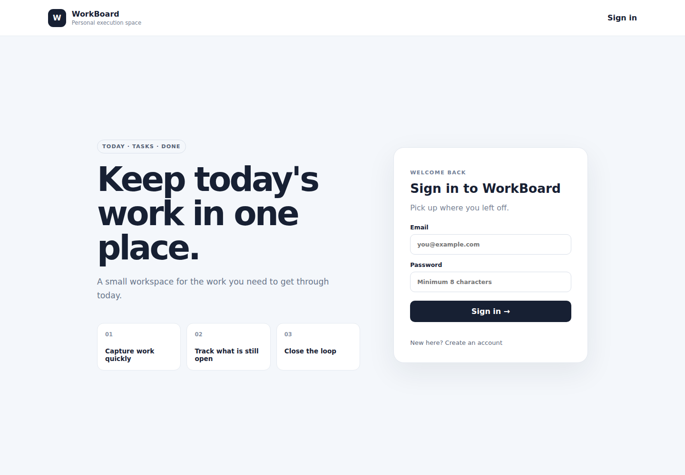
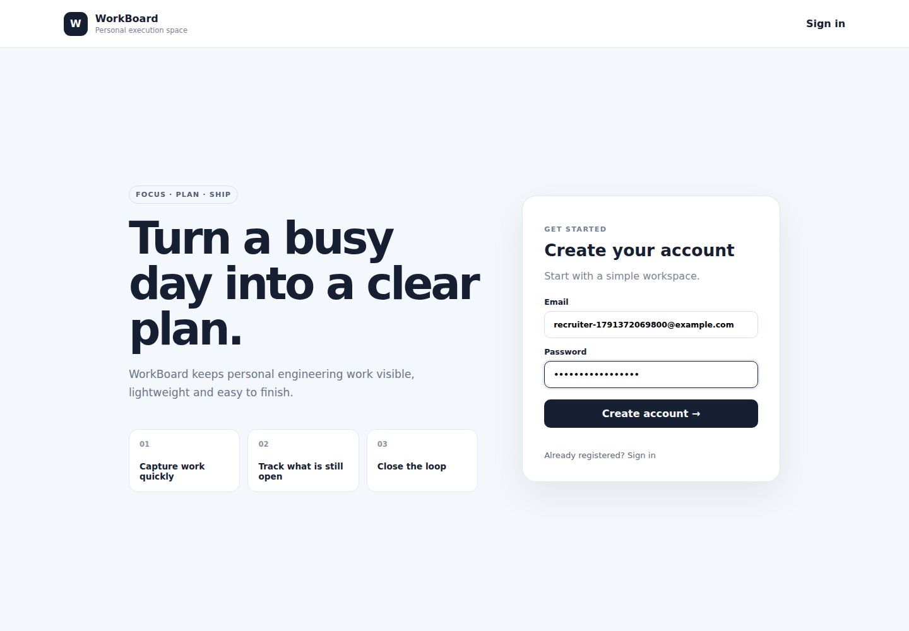
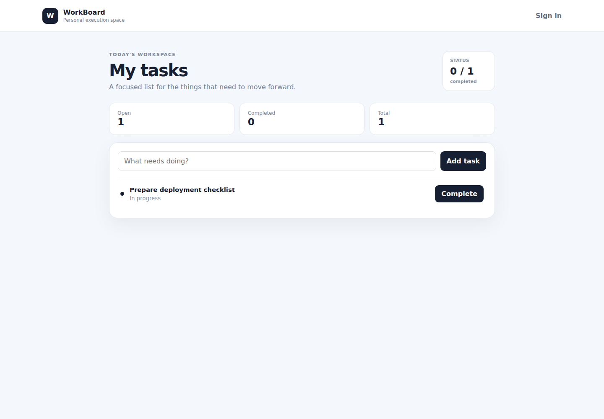
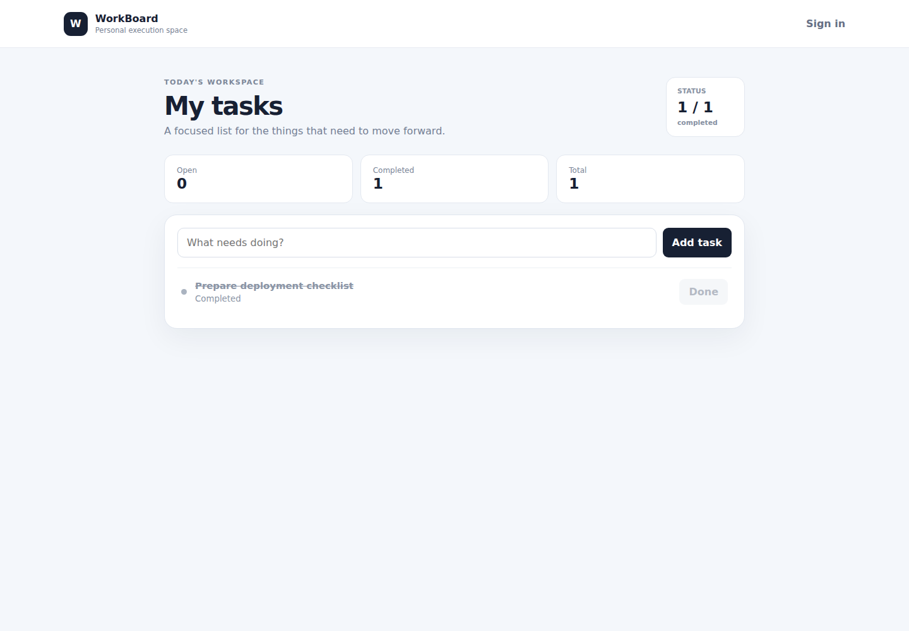

# WorkBoard


**Portfolio role:** a Vue 3 + TypeScript frontend focused on a straightforward personal task workflow. It uses the shared [TaskForge API](https://github.com/imenabidimen/taskforge-api), so authentication and persistence are handled by the backend rather than simulated in the browser.

Related work: [ClientHub (React)](https://github.com/imenabidimen/clienthub-react) uses the same API contract with a separate interface; [Foody](https://github.com/imenabidimen/Abid_Araari_Trabelsi_lglsi2c) is an earlier university project.


WorkBoard is a Vue 3 task list. Sign in, add work, and mark tasks complete. It uses the TaskForge API for authentication and persistence.

## Stack

- Vue 3, TypeScript and Vite
- Vue Router
- Vitest and Vue Test Utils
- TaskForge API (NestJS, PostgreSQL)

## Current features

- Account creation and sign-in
- A route guard for the workspace
- Create tasks and mark them complete
- Open, completed and total counters
- Loading, empty and error states
- Responsive layout and expired-session handling

## Run locally

Start [TaskForge API](https://github.com/imenabidimen/taskforge-api) first, with its API available at `http://localhost:3000/api`. Then run:

```bash
npm install
npm run dev
```

If the API runs at a different address, copy `.env.example` to `.env.local` and set `VITE_API_URL` to the API base URL, including `/api`. Vite reads `.env.local` when starting the dev server.

```bash
npm test
npm run build
```

## Screenshots

The screenshots below are browser captures from the CI workflow, which runs the frontend against TaskForge and PostgreSQL.

### Sign in


### Create an account


### Add a task


### Complete a task


## Implementation note

WorkBoard keeps the task workflow deliberately small. Task ownership and persistence live in the API; the frontend sends a bearer token and displays the returned task state.